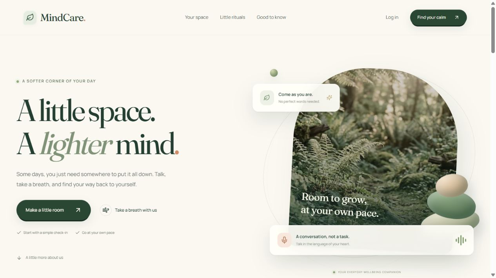

# MindCare

A multilingual AI wellbeing companion for everyday reflection, mood check-ins, and continuous voice conversations.



## What you can do

- **Talk or type:** chat in English, Hindi, Tamil, Telugu, or Nepali, with optional spoken replies.
- **Have an ongoing voice call:** speak across multiple turns until you end the call. After five seconds of silence, a gentle check-in invites you to talk. Microphone mute pauses listening.
- **Interrupt a reply:** speaking during playback stops the AI voice and prioritizes your next turn. Echo cancellation and a short audio buffer help preserve your opening words.
- **Hear female voices:** Jenny (English), Swara (Hindi), Pallavi (Tamil), Shruti (Telugu), and Hemkala (Nepali), using neural speech synthesis. A clearly labeled, AI-generated female portrait gives the call a visual presence; it is not lip-synchronized video.
- **Check in with your mood:** quick and detailed check-ins, recent history, and contextual conversation suggestions. Low or Extremely low selections offer calming music, which starts only after permission.
- **Take a small pause:** the responsive botanical landing page includes a mood preview, a one-minute breathing exercise, floating cards, and subtle 3D effects. New interface animations respect reduced-motion preferences.

MindCare is an AI companion, not a therapist, diagnostic tool, emergency service, or replacement for professional care. Recognition, generated replies, and safety classification can make mistakes.

## How it works

```text
Next.js frontend :3000
    │
    ├── /api/chat ──────── Express backend :5001 → AI provider pipeline
    ├── /api/transcribe ── Nepali: Gemini audio → Whisper large-v3 fallback
    │                     Other languages: Groq Whisper large-v3-turbo
    └── /api/speak ─────── Python edge-tts → female neural voice audio
```

The browser captures microphone audio at 16 kHz. Voice activity detection groups speech into turns; Nepali allows a longer pause within a phrase. Audio goes to the configured transcription service. Conversation history stays associated with the same call ID. Chat uses a multi-provider generation pipeline with emotion, memory, optional graph retrieval, and safety review stages.

The microphone remains active during replies to detect interruptions unless muted. End call cancels browser requests, playback, and microphone capture. Reply audio and its temporary browser URLs are released on stop.

## Run locally

### Requirements

- Node.js 20 or newer and npm
- Python 3.10 or newer, available as `python`
- A microphone and an internet connection for voice mode
- API credentials for the features you want to enable

### 1. Clone and install

```bash
git clone https://github.com/Suyogadk1/Health.git
cd Health
npm ci --prefix backend
npm ci --prefix frontend
python -m pip install -r backend/requirements-voice.txt
```

### 2. Configure environment files

Copy `backend/.env.example` to `backend/.env` and `frontend/.env.example` to `frontend/.env.local`. Enter credentials locally; never commit these files.

Essential backend settings:

| Variable | Purpose |
| --- | --- |
| `PORT` | API port, default `5001` |
| `GEMINI_API_KEY` | Gemini conversation generation and primary Nepali transcription |
| `GEMINI_MODEL` | Primary Gemini model; defaults to the model specified in the provider implementation |
| `NEPALI_TRANSCRIPTION_MODEL` | Optional override for the audio-capable Nepali transcription model |
| `GROQ_API_KEY` | Groq audio transcription key; an existing Groq-format `GROK_API_KEY` also works |
| `AI_STRATEGY` | Provider strategy; default configuration uses failover |
| `TTS_PYTHON` | Optional Python executable path for speech generation |

Additional Gemini backup, Grok/xAI, NVIDIA, Supabase, and Neo4j settings are described in the environment templates. Provider model availability depends on your account; use model IDs available to you.

Essential frontend settings:

```dotenv
BACKEND_URL=http://localhost:5001
NEXT_PUBLIC_API_URL=http://localhost:5001
```

Use `http://localhost:3000` consistently in the browser. Voice recording requires microphone permission and a secure context; localhost is supported for development. Hosted deployments need HTTPS.

### 3. Start both servers

Terminal 1:

```bash
npm run dev:backend
```

Terminal 2:

```bash
npm run dev:frontend
```

Open [the landing page](http://localhost:3000), then enter the guest/demo flow or sign in. API health is available at [localhost:5001/api/health](http://localhost:5001/api/health).

## Voice services and data flow

- Nepali audio is sent to Google's Gemini API when configured. If unavailable, the server tries Groq Whisper large-v3. Other supported languages use Groq transcription.
- Reply text is sent to Microsoft's Edge online speech service through the third-party `edge-tts` Python package. This integration needs internet access and may be affected by upstream changes.
- The transcription and speech routes do not write uploaded audio to disk. This is not a claim about provider retention; review each provider's terms before using sensitive recordings.
- The portrait is fictional and AI-generated. Voices are synthesized presets. No user-specific voice training or cloning is included.
- Headphones can reduce speaker feedback during interruptions. Actual microphone sensitivity and pronunciation depend on the device, environment, and language.

## Project structure

```text
backend/
  src/routes/          Chat, conversation, check-in, transcription and speech APIs
  src/lib/pipeline/    Conversation orchestration and safety stages
  scripts/speak.py     Female neural voice synthesis
  eval/                Existing evaluation harness and datasets
  requirements-voice.txt
frontend/
  src/app/             Next.js pages and local API handlers
  src/components/      Landing page, dashboard, chat and voice interface
  src/lib/voice/       Microphone capture, interruption and speech playback
  public/              Images and bundled calming music
```

## Checks

```bash
npm run build:backend
npx --prefix frontend tsc --noEmit --incremental false -p frontend/tsconfig.json
npm run build:frontend
```

Existing backend evaluations:

```bash
npm test --prefix backend
```

Some evaluation modes use live providers or optional services; see `backend/eval/README.md` for scope and limitations. Browser/device validation should cover all five languages, silence prompts, multi-turn conversation, interruption, mute, hang-up, and music permission. Synthesized audio checks do not establish accuracy for every speaker or accent.

## Deployment boundaries

**This repository currently targets local development and demonstrations.** The supplied authentication contains demo-token and guest shortcuts, and the default backend conversation adapter uses in-memory storage. Do not expose it publicly with sensitive conversations as-is.

Before production use, replace demo authentication and identity shortcuts, enforce server-verified authorization, configure durable per-user storage, review CORS and rate limits, validate provider privacy requirements, and independently evaluate safety behavior. Existing Netlify configuration does not by itself host the long-running Express/Python voice backend; deploy that service separately and set `BACKEND_URL` accordingly.

The app is not an emergency service. For urgent concerns, seek appropriate local human support rather than relying on generated responses.
