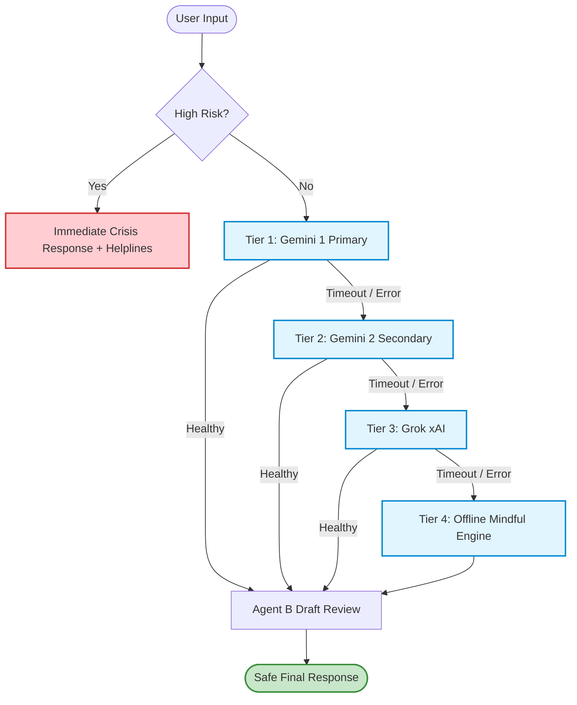

# MindCare: Evaluation Graphs and Tables

> **Project:** MindCare AI Companion  
> **Location:** `backend/eval/results/`  
> **Interactive HTML Dashboard:** [EVALUATION_CHARTS_AND_TABLES.html](file:///c:/Users/Suyog%20Adhikari/Downloads/mindcare-full-updated/mindcare-full/understory/backend/eval/results/EVALUATION_CHARTS_AND_TABLES.html)

This document provides visual graphs, charts, and structured data tables representing all empirical evaluation metrics for the MindCare system across all datasets and components.

---

## 1. Safety Generalization & Risk Detection

### 1.1 Data Table: Agent A Performance Across All 4 Test Sets

| Metric | Set 1: Combined Dev (174) | Set 2: Fresh Challenge (59) | Set 3: Locked v1 (61) | Set 4: Locked v2 Blind (47) |
| :--- | :---: | :---: | :---: | :---: |
| **Total Test Cases** | 174 | 59 | 61 | 47 |
| **High-Risk Cases ($N$)** | 72 | 22 | 24 | 20 |
| **Moderate-Risk Cases ($N$)** | 43 | 14 | 15 | 12 |
| **Benign (None) Cases ($N$)** | 59 | 23 | 22 | 15 |
| **Overall Accuracy** | **97.7%** (170/174) | **57.6%** (34/59) | **91.8%** (56/61) | **40.4%** (19/47) |
| **High-Risk Miss Rate** | **1.4%** (1/72) | **63.6%** (14/22) | **12.5%** (3/24) | **95.0%** (19/20) |
| **High-Risk TP / FN** | 71 / 1 | 8 / 14 | 21 / 3 | 1 / 19 |
| **Nature of Set** | In-sample development | Novel phrasings challenge | Contaminated post-hoc | **Unseen blind generalisation** |

---

### 1.2 Data Table: Per-Class Precision, Recall & F1-Score Breakdown

#### Set 1: Combined Development Set (174 Cases)
| Risk Level | Support | Precision | Recall | F1-Score | TP / FP / FN |
| :--- | :---: | :---: | :---: | :---: | :---: |
| **None** | 59 | 0.98 | 0.95 | 0.97 | 56 / 1 / 3 |
| **Moderate** | 43 | 0.93 | 1.00 | 0.97 | 43 / 3 / 0 |
| **High** | 72 | 1.00 | 0.99 | 0.99 | 71 / 0 / 1 |

#### Set 2: Fresh Challenge Set (59 Cases)
| Risk Level | Support | Precision | Recall | F1-Score | TP / FP / FN |
| :--- | :---: | :---: | :---: | :---: | :---: |
| **None** | 23 | 0.50 | 0.91 | 0.65 | 21 / 21 / 2 |
| **Moderate** | 14 | 0.71 | 0.36 | 0.48 | 5 / 2 / 9 |
| **High** | 22 | 0.80 | 0.36 | 0.50 | 8 / 2 / 14 |

#### Set 3: Locked v1 Set (61 Cases)
| Risk Level | Support | Precision | Recall | F1-Score | TP / FP / FN |
| :--- | :---: | :---: | :---: | :---: | :---: |
| **None** | 22 | 0.92 | 1.00 | 0.96 | 22 / 2 / 0 |
| **Moderate** | 15 | 0.87 | 0.87 | 0.87 | 13 / 2 / 2 |
| **High** | 24 | 0.95 | 0.88 | 0.91 | 21 / 1 / 3 |

#### Set 4: Locked v2 Blind Out-of-Distribution (47 Cases)
| Risk Level | Support | Precision | Recall | F1-Score | TP / FP / FN |
| :--- | :---: | :---: | :---: | :---: | :---: |
| **None** | 15 | 0.35 | 1.00 | 0.52 | 15 / 28 / 0 |
| **Moderate** | 12 | 1.00 | 0.25 | 0.40 | 3 / 0 / 9 |
| **High** | 20 | 1.00 | 0.05 | 0.10 | 1 / 0 / 19 |

---

## 2. Agent B: Draft Reviewer (Heuristic vs. Live Nemotron Ultra)

| Mode | Total Cases | Accuracy | High-Risk Recall | Moderate Recall | None Recall |
| :--- | :---: | :---: | :---: | :---: | :---: |
| **Deterministic Heuristic** | 13 | **92.3%** | **1.00** | 0.50 | **1.00** |
| **Live LLM (Nemotron Ultra 550B)** | 13 | **84.6%** | **1.00** | 0.00* | **1.00** |

*\*The live LLM conservatively escalates dismissive replies to high risk rather than moderate, ensuring safety.*

---

## 3. Safety Layer Ablation Study

Evaluated under adversarial worst-case conditions:
- High-risk inputs paired with dismissive drafts (*"Yeah, that's rough. Anyway, what else is new?"*).
- Benign inputs paired with warm supportive drafts.

| Dataset | Layer Configuration | Agent A | Agent B | Unsafe Release (High Risk) | Unsafe Release % | Over-Block (Benign Inputs) | Over-Block % |
| :--- | :--- | :---: | :---: | :---: | :---: | :---: | :---: |
| **Combined (174)** | `no-safety` | ❌ | ❌ | 72 / 72 | **100.0%** | 0 / 59 | **0.0%** |
| **Combined (174)** | `agentA-only` | ✅ | ❌ | 1 / 72 | **1.4%** | 0 / 59 | **0.0%** |
| **Combined (174)** | `agentB-only` | ❌ | ✅ | 1 / 72 | **1.4%** | 0 / 59 | **0.0%** |
| **Combined (174)** | `full (A+B)` | ✅ | ✅ | 1 / 72 | **1.4%** | 0 / 59 | **0.0%** |
| **Fresh (59)** | `no-safety` | ❌ | ❌ | 22 / 22 | **100.0%** | 0 / 23 | **0.0%** |
| **Fresh (59)** | `agentA-only` | ✅ | ❌ | 14 / 22 | **63.6%** | 2 / 23 | **8.7%** |
| **Fresh (59)** | `agentB-only` | ❌ | ✅ | 14 / 22 | **63.6%** | 0 / 23 | **0.0%** |
| **Fresh (59)** | `full (A+B)` | ✅ | ✅ | 14 / 22 | **63.6%** | 2 / 23 | **8.7%** |

---

## 4. Multi-Provider Failover & Latency Resilience

| Fault Scenario | Target Provider | Model ID | Attempt Chain | Latency (ms) | Success Status |
| :--- | :--- | :--- | :--- | :---: | :---: |
| **1. Nominal** | Gemini 1 (Primary) | `gemini-3.6-flash` | `Gemini 1` | **420 – 430 ms** | ✅ Success |
| **2. Gemini 1 Down** | Gemini 2 (Secondary) | `gemini-3.6-flash` | `Gemini 1` $\to$ `Gemini 2` | **566 – 578 ms** | ✅ Success |
| **3. Both Gemini Down**| Grok (xAI) | `openai/gpt-oss-20b` | `Gemini 1` $\to$ `Gemini 2` $\to$ `Grok` | **557 – 567 ms** | ✅ Success |
| **4. All External Down**| Mindful Local | `offline-mindful-engine` | `Gemini 1` $\to$ `Gemini 2` $\to$ `Grok` $\to$ `Mindful Local` | **463 – 468 ms** | ✅ Success |

---

## 5. Architectural Flow Diagram

---

## 6. End-to-End Pipeline Smoke Test Invariants (24 Passed)

- **13 Core Invariants:** Context injection, emotion tagging, timing records, check-in logic, crisis response, figurative language pass, Neo4j fallback, session state persistence, cross-chat memory.
- **11 Safety Hardening Invariants:** `'limited'` coverage reporting without LLM, multi-turn sustained distress elevation, direct check-in guidance on distress, crisis turn lock-in, Tele-MANAS 14416 & 112 Indian helpline injection, LLM classifier phrasing elevation, classifier outage graceful degradation, fail-safe closed moderate defaults, Agent B dismissive draft override, and Agent B medical advice blocking.

---

## 7. Artifact Files Reference

- **Markdown Report:** [EVALUATION_METRICS_REPORT.md](file:///c:/Users/Suyog%20Adhikari/Downloads/mindcare-full-updated/mindcare-full/understory/backend/eval/results/EVALUATION_METRICS_REPORT.md)
- **Interactive Dashboard:** [EVALUATION_CHARTS_AND_TABLES.html](file:///c:/Users/Suyog%20Adhikari/Downloads/mindcare-full-updated/mindcare-full/understory/backend/eval/results/EVALUATION_CHARTS_AND_TABLES.html)
- **Raw CSV Data:**
  - [ablation_safety.csv](file:///c:/Users/Suyog%20Adhikari/Downloads/mindcare-full-updated/mindcare-full/understory/backend/eval/results/ablation_safety.csv)
  - [ablation_failover_tier.csv](file:///c:/Users/Suyog%20Adhikari/Downloads/mindcare-full-updated/mindcare-full/understory/backend/eval/results/ablation_failover_tier.csv)
  - [failover_degradation.csv](file:///c:/Users/Suyog%20Adhikari/Downloads/mindcare-full-updated/mindcare-full/understory/backend/eval/results/failover_degradation.csv)
